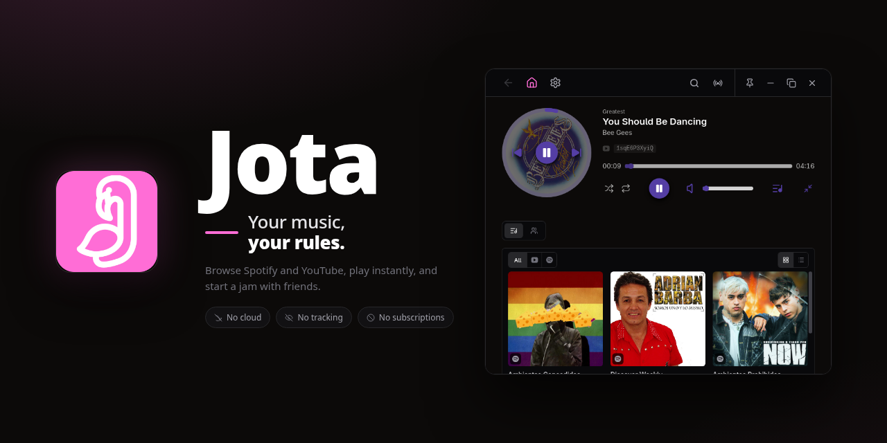
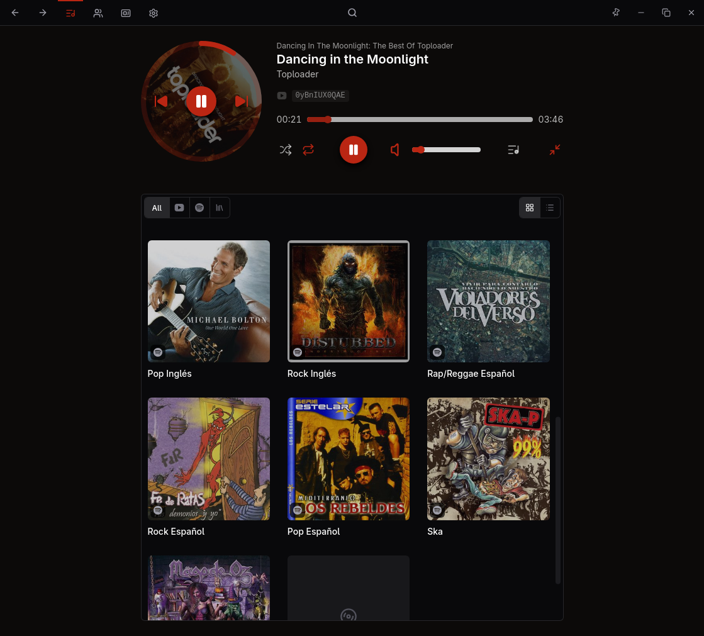
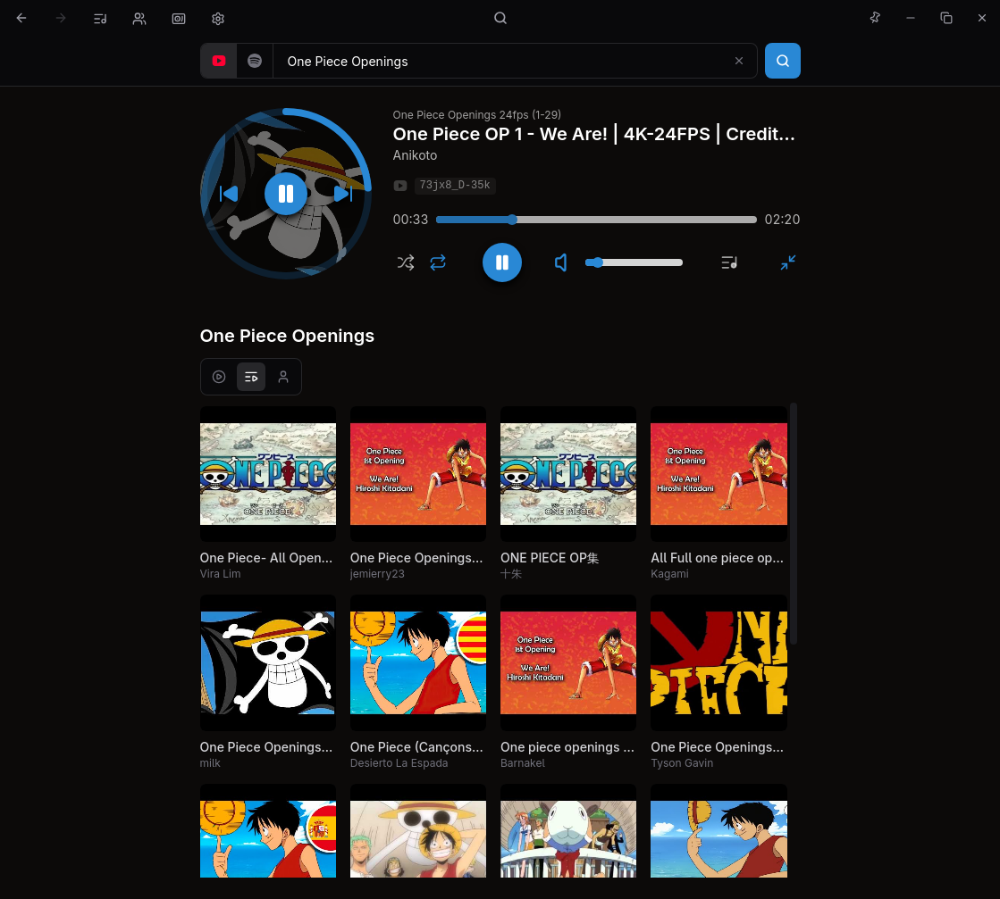
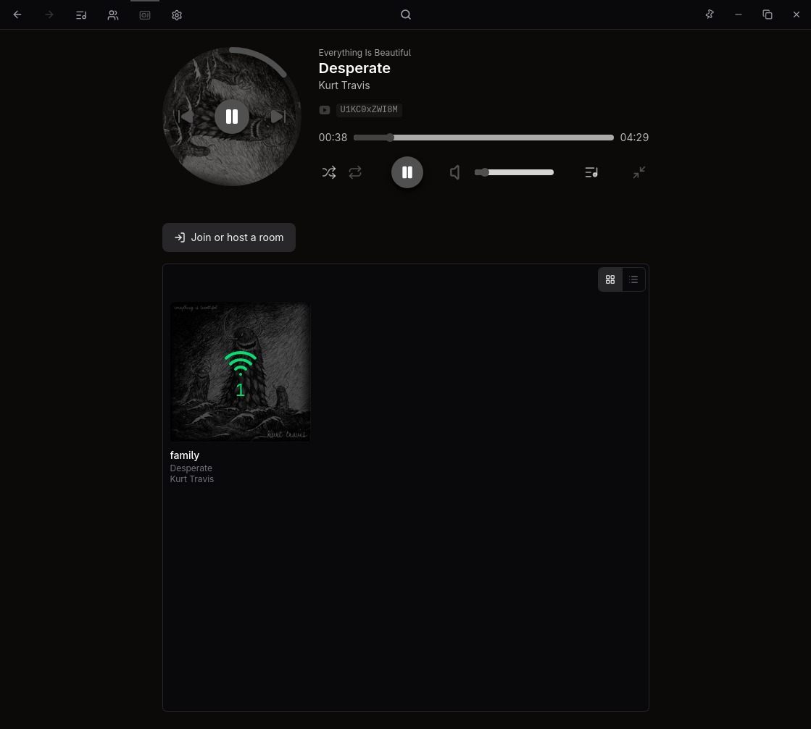

<p align="center">
  
</p>

<h1 align="center">Jondo</h1>

<p align="center">
  A native Rust rebuild of <a href="https://github.com/Jota-Music/jota">Jota</a> —
  <em>your music, your rules</em>.
</p>

> [!WARNING]
> ## Experimental rebuild. Not Jota, not finished.
>
> Jondo is a personal experiment: porting [Jota](https://github.com/Jota-Music/jota)
> from Go and a webview to Rust and GPUI. It inherits Jota's visual language, its
> `jota.backup.json` document and its relay rooms, but it is a different codebase
> with different bugs. Treat it as a workbench, not a product.
>
> - **Expect breakage.** Spotify's private endpoints, YouTube's InnerTube client
>   and browser cookie jars change without notice. A feature that works today can
>   stop working tomorrow, and nothing here promises otherwise.
> - **Keep a backup.** `jota.backup.json` holds your playlists, follows, shelf
>   order and sessions. Copy it somewhere safe before the first run and before
>   every update.
> - **Files are rewritten.** The local state and the backup document change as the
>   code evolves. Writes are atomic and an unreadable state is kept as
>   `state.bad`, but a format change still means an older build cannot read the
>   file.
> - **No support.** No stability guarantees, no SLAs, no migration promises. If you
>   want the app that is meant to work, use
>   [Jota](https://github.com/Jota-Music/jota).
> - **Your accounts, your risk.** Signing in uses your own accounts and cookies.
>   Automating a service can conflict with its terms and can get an account
>   limited. Read the [disclaimer](#disclaimer) before using this.

## What this is

Jondo reimplements Jota natively: stone surfaces, a 672px content column, the
same Lucide icons, the vinyl disc, cover-derived accent colour and the responsive
compact player, rendered by GPUI instead of a webview, with a small streaming
audio engine behind it.

The parts that matter for living alongside Jota are inherited on purpose:

- **The same backup document.** `jota.backup.json` keeps Jota's shape — shared
  `songs`/`albums`/`artists` maps, tombstones, per-record timestamps and its merge
  rules — so both apps can read and write one folder.
- **The same sessions.** Jondo stores the account and credential blob Jota keeps,
  and carries the encrypted YouTube/Spotify sessions through the backup untouched.
- **The same relay rooms.** It speaks the relay protocol used by
  [`Jota-Music/relay`](https://github.com/Jota-Music/relay).

## What works

- **Spotify sign-in** with PKCE and the librespot desktop client id, exchanged at
  the accesspoint for the reusable credentials Jota stores; no developer app,
  client secret or OAuth refresh token.
- **Spotify library** through the private metadata endpoints Jota uses: rootlist,
  playlists, tracks, albums, artists and public playlists.
- **YouTube search and playback** through InnerTube: anonymous first, signed only
  when YouTube asks for it, using the session imported from a supported browser
  (Chromium and Firefox families) or pasted cookies.
- **Local playlists**: create, rename, delete, add tracks from search, drag to
  reorder.
- **Rooms**: join a relay room, share queue and transport, save rooms, configure
  the relay from Settings.
- **Backup sync**: autosave to a folder, direct reads on desktop, SAF on Android,
  manual export/import, encrypted sessions under a shared pass.
- **Settings**: accounts, language (English and Spanish), Discord rich presence,
  relay, backups, logs, About with update check.
- **Player**: seek, volume, shuffle, repeat, queue, dominant-colour accent,
  current-track highlight, resume after a restart.
- **Responsive UI**: full player at wide widths; compact bottom bar and a
  full-player sheet below 768px.
- **Low memory**: AAC streamed with an eight-second buffer and 512KB chunks, so a
  track is never downloaded whole; bounded cover texture cache and a capped
  on-disk cover folder.

**Spotify playback is deliberately not implemented.** Spotify supplies metadata;
the audio always comes from YouTube.

## What is not here

Everything not listed above, and specifically:

- Spotify audio. Do not expect it, now or later.
- Jota's Wails/TypeScript code, its auto-updater channels and its release
  packaging. Jondo has its own updater and its own artifacts.
- Parity with every Jota screen. The port is broad but unfinished; edges differ.

## Assets inherited from Jota

<p align="center">
  
</p>

The icon, the banner and the visual design come from the original Jota (GPL-3.0).
The screenshots below are **the original app**, not this rebuild: they are here to
show the interface Jondo reproduces.

<p align="center">
  
</p>
<p align="center">
  
</p>
<p align="center">
  
</p>

## Build

```bash
cargo run --release
```

Rust 1.88 or newer (the code uses let chains). Linux needs ALSA, Vulkan and the
usual GPUI development packages:

```bash
# Debian/Ubuntu
sudo apt install libasound2-dev libxkbcommon-dev libwayland-dev libx11-dev \
  libfontconfig-dev libfreetype-dev libvulkan-dev
```

For the edit/run loop:

```bash
cargo dev
```

That is an alias for `cargo watch --no-vcs-ignores -w src -w assets -w Cargo.toml -x run`,
defined in `.cargo/config.toml`, and needs `cargo install cargo-watch` once. The
flags are not optional: this crate lives inside a large git repo, and plain
`cargo watch` spends minutes walking it (every `node_modules` and `.pnpm-store`)
to discover `.gitignore` files before it runs anything.

Tests and lints match CI:

```bash
cargo fmt --all --check
cargo clippy --all-targets -- -D warnings
cargo test --all-targets
```

## Platforms

| Platform | Status |
|---|---|
| Linux | Primary target; the release publishes an `.AppImage`. |
| Android | Built from `android/` (a GPUI mobile activity) and published as `jondo.apk`. |
| macOS | Builds from source. |
| Windows | Builds from source. |

The release pipeline publishes `jondo.apk`, `jondo-x86_64.AppImage` and a
`SHA256SUMS` next to them; the updater verifies the checksum before installing.

## Data

Environment variables: `DISCORD_CLIENT_ID` overrides the Discord application used
for rich presence (Jota's by default), `JONDO_HOME` pins the state folder (a
portable install), and `JONDO_REPO` (`owner/name`) enables the release check in
About — without it the panel only links to the repository.

State lives in `~/.config/jondo/state.json` with mode `0600`. Next to it:

- `playlists/` caches track lists, so entering a playlist already seen is instant.
- `covers/` holds cover thumbnails; the folder is capped and trimmed.
- `library.json` holds the last Spotify library, so the shelf paints before the
  network answers.

`state.json` keeps local playlists, the queue, volume, the Spotify session and the
saved relay and rooms, grouped into sections (`youtube`, `spotify`, `sync`,
`relay`, `rooms`, and the `order`/`follows`/`saved` lists with their `at`). Values
equal to their default are not written. Delete it to reset the app; a file that
cannot be read is kept as `state.bad` instead of being overwritten.

## Backup and sync

The library travels in `jota.backup.json`, the document Jota autosaves:
`playlists` (with the shared `songs`/`albums`/`artists` maps), `follows`, `saved`,
`order`, `settings` and `sessions`.

- Desktop reads the folder directly and settles with a `stat` while nothing
  changed.
- Android picks the document with SAF (a folder through the tree picker, a cloud
  file one document at a time). The provider's copy is staged as
  `filesDir/sync/incoming.json`, merged here, and written back from
  `filesDir/sync/outgoing.json` with a truncating stream.
- A provider that serves a cached copy is not written over: the pass marks itself
  stale, reads once more and writes the union. The write baseline only moves once
  the commit confirmed the bytes, so a failed write is retried instead of being
  believed.
- Every pass runs off the UI thread; only the ones you asked for report a status.
- `sessions` (the encrypted YouTube cookies and Spotify credentials) is carried
  through untouched: Jondo does not stage them, so a document written by Jota
  keeps them.

## Project layout

The tree is feature-first: each business concept owns its layers, so a slice can be
read top to bottom without jumping across the crate. The dependency direction is
`views → app → domain`: `domain` holds the types, `app` the use cases and `views`
the outermost consumers. `domain` never depends on gpui, tokio or an adapter.

```
src/
  music/                  the product domain
    catalog/              discovering outside the library
      app/                search, album/artist/user/channel loading, row caches
      views/              search results and the user/artist/album/channel pages
    library/              what the user keeps
      app/                shelf, follows, local playlists, row caches
      views/              shelf, playlist page, create/rename/confirm/picker sheets
    player/
      domain/             queue, shuffle and repeat
      app/                player state, play/pause/seek, audio output and resolution
      views/              disc, full player, compact bar and queue
    rooms/
      domain/             room messages, roles and clock projection
      app/                connection, relay websocket, dial, sync, events and panel
      views/              saved rooms, cards and join panel
    track/
      domain/             YouTube editor mode
      app/                YouTube editor and preview state
      views/              rows, lists, credits, selection, search and the YouTube editor
  settings/
    domain/               Spotify sign-in state
    app/                  sessions, backup/sync, update and presence
    views/                account, interface, backups, relay and about
  shared/                 shared kernel, adapters and UI kit
    browser/app/          browser cookie jars and secrets
    crypto/app/           session encryption and the login foreground hold
    i18n/
      domain/             Locale value object
      app/                English and Spanish copy and active locale
    kernel/app/           clock, duration formatting, loading state and lock helpers
    logs/app/             logging install and capture
    music/
      domain/             Song, Playlist, Album, Artist, Channel, Follow, media and search
      app/                cover cache, Discord presence, Spotify, YouTube and list tables
      views/              cover artwork, mosaics and localized labels
    platform/app/         desktop and Android bridges, heap trimming
    storage/
      domain/             local store, playlist, session and sync report types
      app/                state file, playlist cache and library cache
    ui/
      views/              generic components and design tokens
  shell/                  composition root
    domain/               routes, link targets, commands, gestures and shell state types
    app/                  use cases: Jondo, navigation, jobs, events, clock, setup and drag
    views/                chrome, layouts, header, menu, sheet, page and toolbar
```

## Release

- Android: `./android/build.sh --release` builds both ABIs and packages a signed
  APK. Set `ANDROID_KEYSTORE_FILE`, `ANDROID_KEYSTORE_PASSWORD`,
  `ANDROID_KEY_ALIAS` and `ANDROID_KEY_PASSWORD`, or add a gitignored
  `android/keystore.properties`. The release build refuses to run without them.
- CI (`.github/workflows/ci.yml`) checks format, clippy, tests and the Android
  build. Pushing a `vX.Y.Z` tag runs `.github/workflows/release.yml` and publishes
  `jondo.apk`, `jondo-x86_64.AppImage` and `SHA256SUMS`.
- Build with `JONDO_REPO=Jota-Music/jondo` so the release check points at this
  repository.
- GitHub secrets for the Android release: `ANDROID_KEYSTORE_BASE64`,
  `ANDROID_KEYSTORE_PASSWORD`, `ANDROID_KEY_ALIAS` and `ANDROID_KEY_PASSWORD`.

## Credits

- [Jota](https://github.com/Jota-Music/jota) by
  [salvadorsru](https://github.com/salvadorsru) — the app, its design, its assets,
  its backup format and its relay protocol. Jondo is a rebuild of that work under
  the same licence.
- Icons from [Lucide](https://lucide.dev) (ISC), rendered from the exact SVG
  sources.
- Inter, bundled under the SIL Open Font Licence (`assets/fonts/OFL.txt`).
- Spotify metadata through Spotify's private spclient, using the subset Jota and
  go-librespot rely on.

## Disclaimer

Jondo is an independent, unofficial client and an experiment. It is not
affiliated with, endorsed or sponsored by Spotify AB, Google LLC or any music
label; "Spotify" and "YouTube" are used only to describe interoperability and
remain the property of their owners. It is not the official Jota and does not
speak for it: the original project is the supported one.

It signs into Spotify through the platform's OAuth flow, reads metadata over its
private Connect protocol and plays audio through YouTube's undocumented client
API. It does not bypass Spotify's access controls or play its audio streams, and it
never stores, redistributes or monetizes content: everything is fetched at runtime
from your own session, and streamed audio belongs to its rights holders.

This is a rebuild in progress, built for personal use and shared as-is. It may
stop working, lose data or break your setup at any time; there is no warranty of
any kind, express or implied. By using it you are responsible for complying with
the terms of service and the laws that apply to the platforms you reach through
it. Spotify and Google may restrict, modify or revoke access at any time.

If you want the maintained application, use
[Jota](https://github.com/Jota-Music/jota).

## Licence

GPL-3.0-only. See [`LICENSE`](LICENSE) and [`NOTICE`](NOTICE). As a derivative
work it keeps Jota's licence, and the assets inherited from Jota stay under
GPL-3.0.
